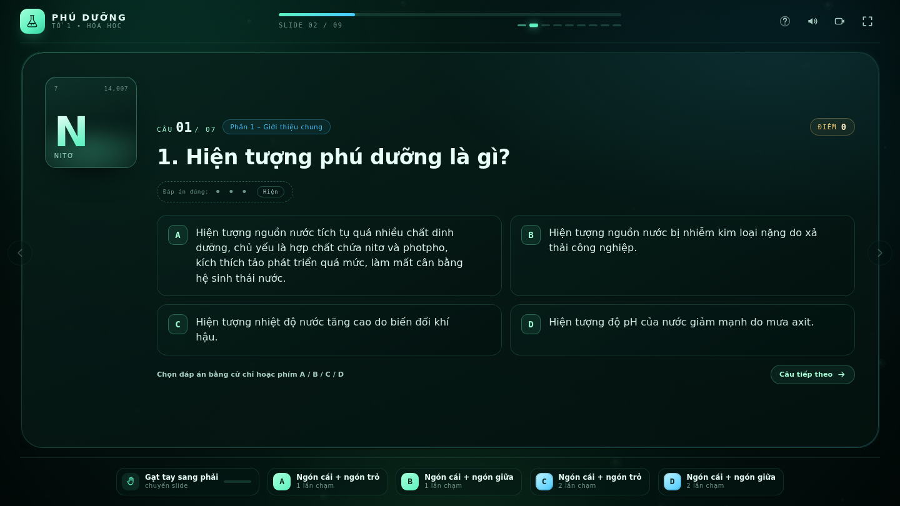
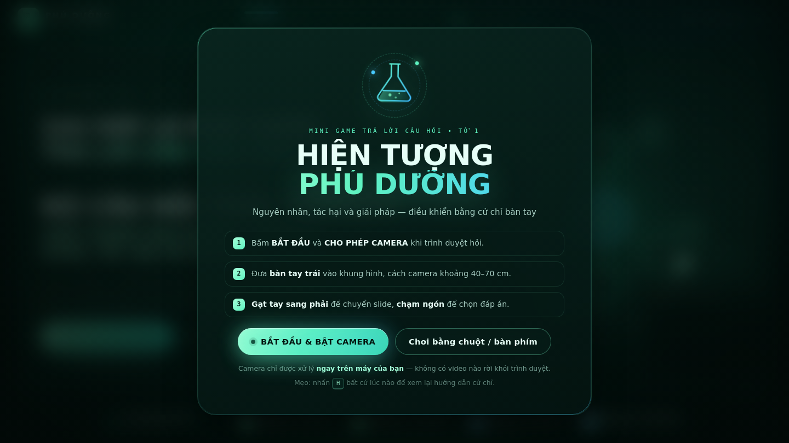
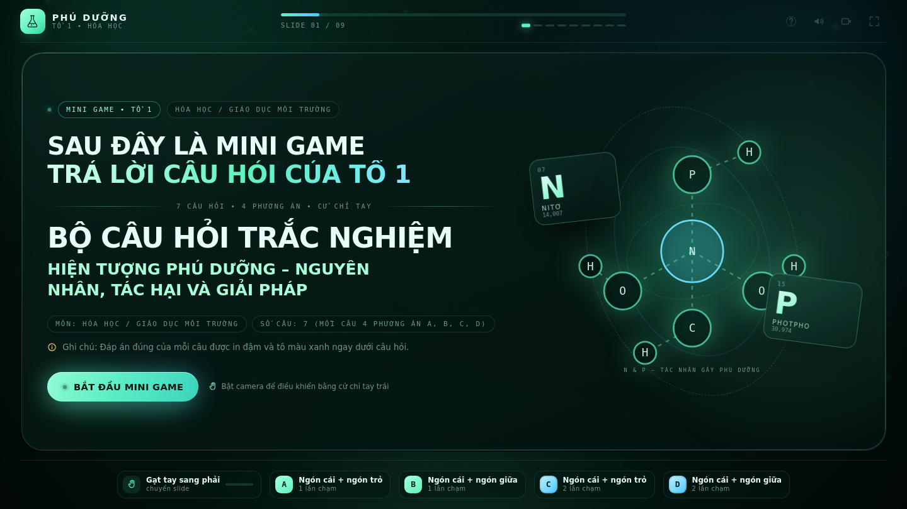
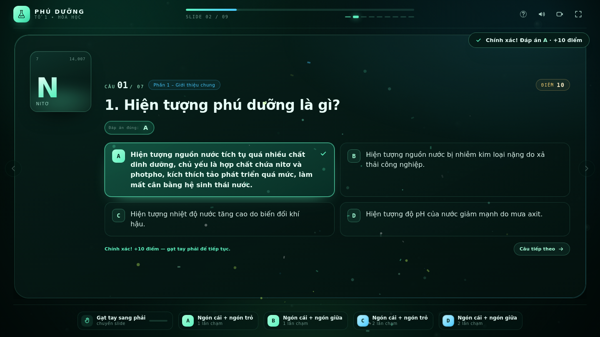
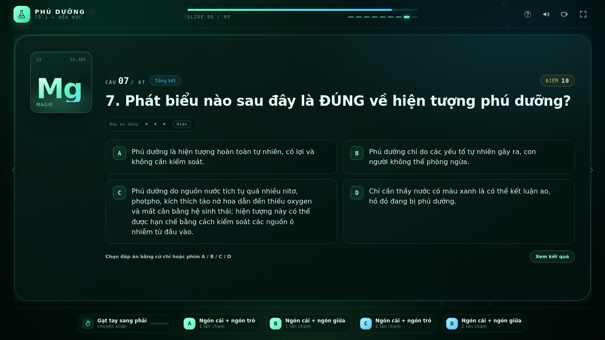

# ⚗️ MINI GAME TRẢ LỜI CÂU HỎI — TỔ 1

**Bộ câu hỏi trắc nghiệm: HIỆN TƯỢNG PHÚ DƯỠNG – NGUYÊN NHÂN, TÁC HẠI VÀ GIẢI PHÁP**
Môn: Hóa học / Giáo dục môi trường — 7 câu hỏi, mỗi câu 4 phương án A, B, C, D.

Website trình chiếu dạng slide, **điều khiển hoàn toàn bằng cử chỉ bàn tay qua camera** (chỉ theo dõi
**tay trái**), có animation, có bảng đáp án và chấm điểm.

| | |
|---|---|
| 🖐️ Nhận diện cử chỉ | MediaPipe Hands (chạy offline, không gửi video lên máy chủ) |
| 🎞️ Trình chiếu | 10 slide: 1 giới thiệu → 7 câu hỏi → 1 video kết thúc → 1 kết thúc |
| 🧩 Kiến trúc | HTML/CSS/JS thuần, chia **module ES**, không cần build |
| 🚀 Triển khai | GitHub Pages (kèm GitHub Actions) |



---

## 1. Cử chỉ điều khiển

| Cử chỉ (tay **trái hoặc phải**, tay nào cũng được) | Tác dụng |
|---|---|
| **Ngón cái chạm ngón trỏ** | Chọn **A** |
| **Ngón cái chạm ngón giữa** | Chọn **B** |
| **Ngón cái chạm ngón áp út** | Chọn **C** |
| **Ngón cái chạm ngón út** | Chọn **D** |
| **Giơ cả 2 tay** lên trước camera | Chuyển sang câu / slide tiếp theo (từ câu 7 → **slide 9 phát video**) |
| **Búng tay** (cần bật micro) | Phát video kết thúc `end/outro.mp4` toàn màn hình |

> Cách hoạt động: engine đo khoảng cách từng cặp đầu ngón rồi chia theo kích thước bàn tay. Cặp nào
> đang chạm thì **kích hoạt ngay tại lúc chạm** — không cần giữ, không cần nhả; mỗi lần chạm chỉ tính
> **một** hành động, muốn chọn lại phải nhả ngón ra. Nếu 2 cặp cùng chạm mà không phân biệt rõ (ví dụ
> ngón cái chạm cả trỏ và giữa) thì web **không đoán bừa** — nó bỏ qua khung đó.
>
> **Chuyển trang chỉ bằng một cách: giơ cả hai tay** — cả tay trái và tay phải ở nửa trên khung hình,
> khác nhãn trái/phải, cách xa nhau, kích thước tương đương, và giữ đủ 3 khung hình liên tiếp mới tính.
> Sau đó phải **hạ tay xuống rồi giơ lại** mới sang câu tiếp. Khi thấy 2 tay, web **không đoán đáp án**
> nữa. Giơ một tay **không** chuyển trang (chế độ chuyển trang bằng 1 tay đã tắt sẵn —
> `gestures.allowOneHandNext: false` — chỉ bật nếu bạn thật sự muốn dùng lại tư thế trỏ + giữa bắt chéo).

> **Chống nhận nhầm mặt/đồ vật thành tay:** mỗi kết quả của mô hình được kiểm tra hình học trước khi dùng —
> tỉ lệ (gốc ngón trỏ → gốc ngón út)/(cổ tay → gốc ngón giữa) và (cổ tay → đầu ngón giữa)/bàn tay phải nằm
> trong khoảng của bàn tay thật, độ tin cậy đủ cao, khung hình không quá nhỏ. Kết quả "ảo" bị **loại**,
> nên mô hình có trả về 2 "bàn tay" trong khi bạn chỉ giơ 1 tay thì web vẫn coi là 1 tay. Ngưỡng ở
> [`js/config.js`](js/config.js) → `hand.plausibility`. Bảng chẩn đoán (`?debug=1` hoặc nút chẩn đoán)
> hiện thêm dòng **"Tay nhận được / bị loại"** để bạn thấy ngay. Ngưỡng "2 tay": `hand.bothHandsMaxY`,
> `hand.twoHandsMinGap`; ngưỡng chạm ngón: `gestures.chord`.

**Tốc độ:** quét ở **30 khung/giây** (mục tiêu), khung đưa vào mô hình thu về **384 px** để suy luận
nhanh, landmark làm mượt EMA α = 0,8. Nếu máy không đạt nổi ~18 khung/giây, web **tự hạ độ phân giải
khung vào** từng bước (384 → 320 → 256 px) cho tới khi mượt. Không dùng cử chỉ gạt/vuốt tay.

Web nhận **cả hai bàn tay**: mỗi tay được theo dõi riêng, nên bạn chạm ngón bằng tay trái hay tay phải
đều chọn được đáp án. Khung xương của tay thứ hai hiện **mờ** trong cửa sổ camera nhỏ để bạn thấy web
đang thấy cả 2 tay. Khi cả 2 tay cùng chạm ngón trong một khung hình, web chỉ chọn **một** đáp án
(cặp rõ ràng nhất) chứ không bắn 2 lần. Nếu chạm ngón mà không ăn,
mở bảng **H** → mục **Độ nhạy cử chỉ** → chọn **Mạnh** (ngưỡng "chạm" rộng hơn).

Phím tắt dự phòng (khi không dùng camera): `→`/`Space` slide tiếp, `←` lùi, `A B C D` chọn đáp án,
`R` hiện đáp án, `F` toàn màn hình, `S` âm thanh, `V` nền camera, `E` chiếu video kết thúc,
`H` bảng hướng dẫn.

---

## 1b. Âm thanh đúng/sai & video kết thúc (file tự đặt)

Ba thư mục ở gốc dự án — **giữ đúng tên file**, chỉ cần chép file của bạn vào:

```
dung/dung.mp3    → phát khi chọn ĐÚNG đáp án
sai/sai.mp3      → phát khi chọn SAI
end/outro.mp4    → phát TOÀN MÀN HÌNH khi búng tay (hoặc bấm phím E)
```

- Chưa có file nào cũng **không lỗi**: đúng/sai tự dùng âm tổng hợp bằng Web Audio, video thì hiện
  thông báo nhẹ và chuyển tới slide kết thúc.
- Nếu muốn đặt tên/đường dẫn khác, sửa danh sách trong [`js/config.js`](js/config.js) → `media.correct`,
  `media.wrong`, `media.video` (mỗi mục là mảng đường dẫn thử lần lượt).
- Video nên là **MP4 (H.264 + AAC)** để Chrome/Edge/Safari/Firefox đều phát được.
- Mở bảng **H** để xem web đã tìm thấy file nào, nghe thử `dung`/`sai`, và bật/tắt micro.
- **Slide 9 là slide video:** giơ cả 2 tay từ câu 7 (hoặc bấm →) là tới slide này, video **tự phát
  toàn màn hình**; đóng video vẫn đứng ở slide 9, giơ 2 tay lần nữa để sang slide 10 (bảng đáp án).
- **Búng tay dùng micro** (búng tay là âm thanh nên mô hình bàn tay không nhận ra): web đo năng lượng
  cao tần trên từng khung ~12 ms, chỉ nhận xung **sắc và nổi bật** so với tạp âm nền, cách nhau ≥ 320 ms.
  Lần đầu bật sẽ hỏi quyền **micro**; từ chối cũng không sao — dùng phím `E`.
- Nhấn `Esc` (hoặc `E`, `Enter`, nút **ĐÓNG**) để thoát video; video chạy hết tự đóng.

---

### Giao diện

| | |
|---|---|
|  |  |
|  |  |

---

## 2. Chạy thử trên máy

```bash
npm start          # http://localhost:3000
```

Trình duyệt chỉ cho phép dùng camera trên **HTTPS** hoặc **localhost**. Nếu mở trực tiếp bằng
`file://` sẽ không xin được quyền camera (khi đó vẫn chơi được bằng chuột/bàn phím).

Máy chủ tĩnh này không cần cài dependency (`node tools/serve.mjs`).

---

## 3. Cấu trúc dự án

```
.
├── index.html              # khung trang: cổng xin quyền camera, deck, selfview, modal hướng dẫn
├── preview.html            # bản xem trước 1 file (CSS/JS đã nhúng) — tiện gửi bạn bè/nộp bài
├── css/
│   ├── base.css            # reset, biến thiết kế, nền hóa học, cổng camera, modal
│   ├── theme.css           # panel kính, tag, toast, flash
│   ├── stage.css           # topbar, deck, camera mini, thanh cử chỉ, responsive
│   ├── slides.css          # 3 loại slide: giới thiệu / câu hỏi / kết thúc
│   └── animations.css      # toàn bộ keyframes (trượt slide, pháo giấy, nhịp thở…)
├── js/
│   ├── app.js              # điểm khởi động, nối dữ liệu ↔ UI ↔ cử chỉ, phím tắt
│   ├── config.js           # ngưỡng camera + cử chỉ (tinh chỉnh độ nhạy ở đây)
│   ├── data/
│   │   └── slides.js       # ★ NỘI DUNG 7 CÂU HỎI + BẢNG ĐÁP ÁN (giữ nguyên bản gốc)
│   ├── core/
│   │   ├── handTracking.js # camera + MediaPipe Hands + làm mượt landmark (nhiều tay)
│   │   ├── gestures.js     # cặp ngón chạm (A/B/C/D) trên từng tay + giơ 2 tay (chuyển câu)
│   │   ├── mediaAssets.js  # tìm & phát dung.mp3 / sai.mp3 / outro.mp4 (tự dò đường dẫn)
│   │   ├── snapDetector.js # nghe micro, nhận tiếng búng tay
│   │   └── game.js         # trạng thái làm bài, chấm điểm (không đụng DOM)
│   ├── ui/
│   │   ├── deck.js         # quản lý slide, hiệu ứng chuyển
│   │   ├── slideRenderer.js# sinh DOM cho 3 loại slide
│   │   ├── hud.js          # tiến độ, điểm, trạng thái tay, chip cử chỉ
│   │   ├── handOverlay.js  # vẽ khung xương bàn tay + vòng sáng khi chạm ngón
│   │   ├── effects.js      # bong bóng nền, pháo giấy, toast, flash
│   │   └── help.js         # modal hướng dẫn
│   └── utils/
│       ├── dom.js          # tiện ích DOM
│       ├── math.js         # khoảng cách, EMA smoother
│       └── audio.js        # âm thanh tổng hợp bằng Web Audio (không cần file mp3)
├── assets/
│   ├── favicon.svg
│   └── vendor/mediapipe/hands/   # MediaPipe Hands 0.4 (wasm + model) — chạy offline
├── dung/                   # ★ dung.mp3  (âm khi chọn đúng)
├── sai/                    # ★ sai.mp3   (âm khi chọn sai)
├── end/                    # ★ outro.mp4 (video phát khi búng tay)
├── tools/
│   ├── serve.mjs           # máy chủ tĩnh
│   └── build-preview.mjs   # gộp CSS/JS → preview.html
└── tests/                  # content · gestures · game · handFilter · snapMedia — 74 test
```

### Các module chính

- **`data/slides.js`** — nguồn nội dung duy nhất. Sửa câu hỏi/đáp án tại đây, giao diện tự cập nhật.
- **`core/handTracking.js`** — mở camera, nạp mô hình, chỉ lấy bàn tay được cấu hình
  (`CONFIG.hand.trackedHand = 'Left'`), làm mượt bằng EMA.
- **`core/gestures.js`** — tách riêng thuật toán, không phụ thuộc DOM; nhận sự kiện
  `onSwipeNext / onSwipePrev / onOption / onProgress`.
- **`ui/slideRenderer.js`** — 3 hàm `renderIntro()`, `renderQuestion(q)`, `renderOutro()`.
- **`core/game.js`** — lưu lựa chọn, tính điểm, cung cấp `stats` cho slide kết thúc.

---

## 4. Nội dung câu hỏi

Toàn bộ nội dung nằm nguyên văn trong [`js/data/slides.js`](js/data/slides.js):

| Câu | Phần | Đáp án |
|---|---|---|
| 1 | Phần 1 – Giới thiệu chung | **A** |
| 2 | Phần 2 – Nguyên nhân | **C** |
| 3 | Phần 3 – Cơ sở hóa học | **A** |
| 4 | Phần 4 – Diễn biến | **B** |
| 5 | Phần 5 – Tác hại | **C** |
| 6 | Phần 6 – Biện pháp hạn chế và khắc phục | **B** |
| 7 | Tổng kết | **C** |

Slide câu hỏi hiển thị dòng **"Đáp án đúng: • • •"** ngay dưới câu hỏi; đáp án chỉ lộ ra khi bấm
**Hiện** (hoặc phím `R`) — để không lộ đáp án khi đang trình chiếu.

Khi người chơi chọn:

- **Đúng** → ô vừa chọn chuyển **xanh**, có dấu ✓, cộng điểm.
- **Sai** → chỉ ô vừa chọn chuyển **đỏ**, có dấu ✗, ô đó bị khoá; **các ô còn lại vẫn chọn được**
  để người chơi chọn lại **cho tới khi đúng**. Không tự tô xanh đáp án đúng, không hiện đáp án.
- Chỉ khi chọn **đúng** mới khoá cả câu, cộng điểm và hiện đáp án. Người dẫn chương trình có thể bấm
  **Hiện** / `R` bất cứ lúc nào nếu muốn công bố sớm.

---

## 5. Đưa lên GitHub & bật GitHub Pages

```bash
git init
git add .
git commit -m "Mini game trắc nghiệm hiện tượng phú dưỡng — điều khiển bằng cử chỉ tay"
git branch -M main
git remote add origin https://github.com/<tài-khoản>/<tên-repo>.git
git push -u origin main
```

Sau đó vào **Settings → Pages → Build and deployment → Source: GitHub Actions**.

Repo đã kèm workflow [`.github/workflows/deploy.yml`](.github/workflows/deploy.yml): mỗi lần push
lên `main` sẽ tự xuất bản site tại `https://<tài-khoản>.github.io/<tên-repo>/`.
(Nếu muốn dùng nhánh `gh-pages` thủ công: chọn *Deploy from a branch* → `main` → `/ (root)`.)

> GitHub Pages phục vụ qua HTTPS nên camera hoạt động bình thường. Ấn **F** để toàn màn hình khi
> thuyết trình.

---

## 6. Tinh chỉnh nhanh

| Muốn đổi | Sửa ở |
|---|---|
| Ngưỡng chạm ngón (`touchOn`, `touchOff`, `margin`, `cooldownMs`) | `js/config.js` → `gestures.chord` |
| Tốc độ quét (`camera.fps`, `hand.inputWidth`, `hand.smootherAlpha`) | `js/config.js` |
| Độ phân giải khung đưa vào mô hình (`camera.width/height`, `hand.inputWidth`) | `js/config.js` |
| Theo dõi tay phải / tự động | nút **H** → "Nếu máy nhận nhầm tay" |
| Nội dung câu hỏi, đáp án, bảng đáp án | `js/data/slides.js` |
| Điểm mỗi câu đúng | `js/config.js` → `scoring.correct` |
| Tốc độ khung hình nhận diện | `js/config.js` → `camera.fps` |

Sau khi sửa, tạo lại bản 1 file: `npm run build:preview`.

---

## 7. Quyền riêng tư & tương thích

- Video camera **không rời khỏi trình duyệt**: mô hình MediaPipe được tải từ chính repo này
  (`assets/vendor/mediapipe/hands`), toàn bộ suy luận diễn ra trên máy người dùng.
- Khuyến nghị Chrome / Edge / Cốc Cốc / Safari (bản mới). Trình duyệt trong iframe xem trước có
  thể chặn camera → vẫn chơi được bằng chuột/bàn phím.
- Nếu trang nhúng trong iframe của bên thứ ba, thẻ iframe cần `allow="camera"`.

## 8. Xử lý sự cố

| Hiện tượng | Cách xử lý |
|---|---|
| Không thấy hộp thoại xin quyền camera | Kiểm tra biểu tượng 🔒 trên thanh địa chỉ → *Camera: Cho phép*; đảm bảo đang chạy HTTPS/localhost |
| Camera báo "đang bận" | Đóng Zoom/Meet/OBS… rồi tải lại trang |
| Một lần chạm bị nhận 2 lần | Tăng `cooldownMs` trong `gestures.chord` (mặc định 700 ms) |
| Chạm ngón út / áp út không ăn | Ngón cái với tới khó — nghiêng bàn tay một chút hoặc tăng `touchOn` lên 0,42 |
| Máy nhận nhầm tay phải | Không cần đổi — web dùng bàn tay đang thấy trước camera |
| Chạm ngón quá khó | `H` → **Độ nhạy cử chỉ** → **Mạnh** (ngưỡng chạm rộng hơn) |
| Chạm bị nhận nhầm đáp án khác | `H` → mức **Nhẹ** (phải chạm sát hơn mới tính) |
| Giơ 2 tay / chéo ngón không chuyển câu | Giơ cao cả 2 tay vào khung (~0,3 giây), hạ xuống rồi giơ lại để sang câu kế; nếu chỉ giơ 1 tay thì nhớ gập áp út + út |
| Cử chỉ 2 tay làm máy chậm | Web đã tự hạ độ phân giải khung vào; có thể đặt `hand.maxNumHands: 1` trong `config.js` nếu chỉ dùng cử chỉ 1 tay |
| Camera nhận nhầm mặt/đồ vật thành tay | Đã tự lọc bằng `hand.plausibility`; nếu vẫn còn, xiết `spread: [0.5, 1.8]` hoặc nâng `minScore` lên 0,6 |
| Giơ 1 tay mà vẫn chuyển trang | Kiểm tra `gestures.allowOneHandNext` phải là `false`; xem dòng "Tay nhận được / bị loại" trong chẩn đoán |
| Máy chỉ chạy 6–10 khung/giây | Web tự hạ độ phân giải khung vào; đóng bớt ứng dụng nặng, dùng Chrome/Edge bản mới |
| **Không rõ vì sao camera không chạy** | Bấm nút **chẩn đoán** (biểu tượng sóng ↗ trên thanh công cụ) hoặc "Camera không hoạt động?" ở cổng bắt đầu |

### Bảng chẩn đoán camera (mới)

Nút chẩn đoán cho biết ngay nguyên nhân thường gặp và cách sửa:

- Trang đang chạy **HTTPS/localhost** hay không (camera bắt buộc).
- Có đang bị nhúng trong **iframe** (khung xem trước) — nơi trình duyệt luôn chặn camera.
- **Quyền camera**: granted / denied / prompt.
- Danh sách **camera**, độ phân giải, trạng thái luồng video.
- **Mô hình** đã nạp chưa, nguồn (repo offline hay CDN dự phòng), FPS, số khung hình có tay.
- Nút **KIỂM TRA CAMERA** (gọi getUserMedia độc lập, hiện tên lỗi chính xác).
- Nút **THỬ NHẬN DIỆN TAY NGAY**: chụp đúng khung hình camera đang thấy, cho mô hình nhận diện 1 lần và
  hiện ảnh chụp + kết quả (thấy tay hay không, tay trái/phải, độ tin cậy). Đây là cách nhanh nhất để biết
  "camera chết" hay "mô hình không thấy tay".
- Nút **SAO CHÉP KẾT QUẢ** để gửi cho người hỗ trợ.

### Mẹo quan trọng nhất nếu web "không thấy tay"

1. **Lùi tay ra xa camera 40–70 cm** — đủ để thấy cả cổ tay trong khung. Tay quá gần (che kín
   khung hình) là nguyên nhân phổ biến nhất khiến mô hình không nhận ra.
2. **Bật đèn phía trước mặt**, tránh ngược sáng (cửa sổ ở sau lưng).
3. **Xòe bàn tay hướng về camera**, các ngón tách nhẹ.
4. Bấm nút **chẩn đoán** → **THỬ NHẬN DIỆN TAY NGAY** để xem chính xác khung hình mô hình nhận được
   và kết quả nhận diện.
5. Nếu vẫn khó: mở **H** → **Độ nhạy: Mạnh** và bật **Tăng sáng khung hình**.

### Tự phục hồi (không cần bấm gì)

| Tình huống | Web tự làm |
|---|---|
| Một lần gửi khung hình bị treo > 4 giây | Bỏ qua khung đó, tạo lại mô hình (tối đa 3 lần) |
| Không có kết quả trả về > 8 giây | Khởi động lại mô hình MediaPipe |
| Có khung hình nhưng 4 giây không thấy tay | Nâng lên mô hình chính xác cao (full) |
| Vẫn không thấy tay sau 6 giây nữa | Hạ ngưỡng tin cậy xuống 0.32/0.30 + nhắc cách đặt tay |
| WebGL/GPU lỗi (mô hình trả về rỗng) | Lần phục hồi thứ 2 tự chuyển sang suy luận **CPU** |
| Phòng tối / camera mờ | Tự **tăng sáng – tương phản** khung hình trước khi nhận diện (tắt được trong H) |

Khung camera nhỏ ở góc màn hình hiện **"x FPS · y KHUNG CÓ TAY"** để biết mô hình có đang chạy thật không.

### Những chỗ dễ làm camera "không hoạt động"

| Tình huống | Kết quả | Cách khắc phục |
|---|---|---|
| Xem trong **khung preview của app** (iframe sandbox) | Camera bị chặn, chỉ chơi được bằng chuột | Mở web trong tab riêng: `npm start` → `http://localhost:3000` |
| Mở `index.html` bằng **file://** | JS module bị chặn → trang "đứng" | Dùng `preview.html`, hoặc chạy `npm start`, hoặc GitHub Pages (web nay hiện banner hướng dẫn) |
| Mở bằng **http://IP-lan** (không phải localhost) | Không phải secure context → chặn camera | Dùng localhost hoặc HTTPS |
| Trình duyệt đã **chặn quyền** từ trước | Hộp thoại không hiện lại | Bấm 🔒 trên thanh địa chỉ → Camera → Cho phép → tải lại |
| Camera đang bị **Zoom/Meet/OBS** chiếm | `NotReadableError` | Đóng ứng dụng đó rồi thử lại |

---

© Tổ 1 — Hóa học / Giáo dục môi trường. Mã nguồn phục vụ mục đích học tập.
